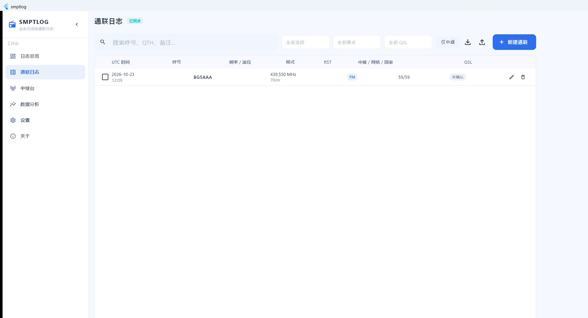
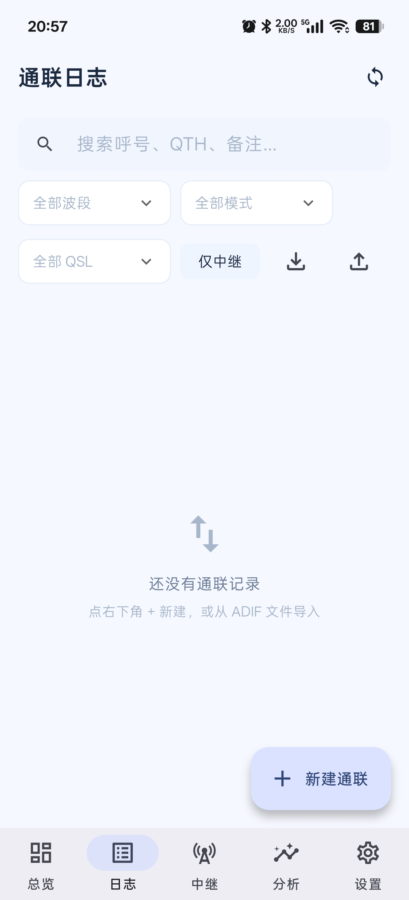

# SMPTLOG 通联日志助手

> 业余无线电通联日志记录工具 · Android + Windows 双端 · 本地优先 · 可选的 EdgeOne 云端同步

<p>
  
  
  
  
  
</p>

**中文** | [English](README.en.md)

---

## 这是什么

一个给业余无线电爱好者自己用的通联日志工具。手动录入、ADIF 导入导出、中继台档案、奖状追踪、数据分析全都**离线可用**；只有当你主动点「同步」时，才会把日志加密后上传到你自己的腾讯云 EdgeOne Makers Blob 空间。

**没有账号、没有服务端、不采集任何个人信息。** 你的日志永远在你自己手里。

| 能力 | 说明 |
|---|---|
| 通联日志 | 新建 / 编辑 / 删除、四维筛选、搜索、排序、批量改 QSL、疑似重复检测 |
| ADIF | 导入（进度 + 错误行报告 + 重复三策略）、导出（含中继扩展字段） |
| 中继台 | 独立档案库、常用置顶、距离方位角自动算、反向查看经由它的全部通联 |
| 奖状追踪 | 波段、模式、DXCC、中继、QSL 五类进度条 |
| 数据分析 | 24 小时时段分布、按年份统计、Top 10 呼号、波段/模式汇总 |
| 备份 | JSON 全量（含中继与电台档案）、CSV（Excel 友好） |
| 云同步 | EdgeOne Makers Blob，每设备独立命名空间 + 读时合并，冲突留副本 |
| 端到端加密 | AES-256-GCM，可选开关，密码只在本机 |
| 响应式 | 手机底部导航 / 平板侧轨 / 桌面可折叠侧边栏 |
| 纯本地计算 | Maidenhead 网格互转、大圆距离、方位角、日出日落/明暗线 |

---

## 截图

| 桌面端（Windows 11） | 手机端（Android） |
|---|---|
|  |  |

**桌面端**：左侧工作台导航 + 顶栏筛选，表格支持批量选择、行内编辑与删除。
**手机端**：卡片列表 + 底部五个标签（总览 / 日志 / 中继 / 分析 / 设置），右下角悬浮按钮快速新建。

---

## 目录结构

```
无线电通联日志助手/
├── SRC/                     Flutter 工程源码（android/ + windows/ + lib/）
│   └── smptlog/
│       ├── lib/
│       │   ├── core/        模型、SQLite、ADIF、备份、网格与天文算法
│       │   ├── sync/        STS 凭证、COS 签名、Blob 客户端、合并引擎、加密、凭据保管
│       │   ├── ui/          页面与通用组件
│       │   ├── app.dart     响应式外壳 + 快捷键
│       │   ├── state.dart   全局状态（provider）
│       │   └── main.dart    入口
│       ├── android/         包名 com.smptlog.app，minSdk 26
│       ├── windows/         Windows runner
│       ├── installer/       Inno Setup 安装脚本
│       ├── docs/            数据规范
│       └── test/            单元测试（网格/几何/ADIF/判重）
├── APK/                     Release 产物
├── EXE/                     Release 产物（单文件安装程序）
├── TEMP/                    临时文件、参考工程、抓包与验证脚本
└── README.MD
```

---

## 快速开始（用户版）

### Windows

1. 双击 `EXE/SMPTLOG-Setup-1.0.0.exe`
2. 一路下一步（**当前用户安装，不需要管理员权限**）
3. 程序装到 `%LOCALAPPDATA%\Programs\SMPTLOG`
4. 数据在 `%LOCALAPPDATA%\SMPTLOG\data\smptlog.db`（卸载时可选保留）

### Android

1. 安装 `APK/SMPTLOG-v1.0.0.apk`（需要允许「安装未知来源应用」）
2. 最低支持 **Android 8.0（API 26）**
3. 首次启动若提示通知权限，建议允许（用于导入完成/同步失败提示）

### 云同步怎么开（可选）

1. 注册腾讯云 → 开通 **EdgeOne Makers（原 Pages）** 免费版
2. 新建任意一个项目，记下 **projectId**（形如 `pages-urtsvuwmfvli`）
3. 控制台 → 设置 → **API Token** → 创建 Token
   - **强烈建议：专用 Token + 有效期 90 天，不要用账号主 Token**
4. 在 App 的「设置 → 云同步」里填 projectId 与 Token → 测试连接 → 保存
5. 另一台设备重复步骤 4（Token 不会自动带过去，需手工再填一次）

> 免费版容量 1 GB。按每条通联压缩后约 150 字节估算，可存 **数万条**记录。

---

## 数据安全设计

这是本项目的核心约束，写进代码也是写进文档：

1. **API Token 与同步密码绝不写入 SQLite 数据库**（数据库本身会被同步和导出）
2. **任何导出文件都不含 Token 与密码**
3. Windows 用 **DPAPI**（`CryptProtectData`，当前用户范围）加密保存凭据 → `%LOCALAPPDATA%\SMPTLOG\config\secrets.bin`
4. Android 用 **Keystore**（AES-256-GCM）包裹，密文落 `noBackupFilesDir`
5. 日志输出中的 Token 一律脱敏
6. 开启端到端加密后，云端只有密文；忘记密码则无法恢复，**请务必先导出一次明文备份**
7. 换设备必须重新填写 Token（这是设计，不是缺陷）

---

## 使用说明（第一次用先看这个）

程序打开就能用。建议按下面顺序花 5 分钟配置一次，之后录入会快很多。

### 第 1 步：建立电台档案

`设置` → `电台档案` → `新增`

填：名称（如「车台」）、己方呼号、网格、设备、天馈、功率。
可以建多个（手持机 / 车台 / 基地台），其中一个点 `设为默认`。

> 作用：录入通联时自动带出呼号、网格、设备、功率，不用每次手打。

### 第 2 步：建立中继台档案（用中继才需要）

`中继台` → `新建中继台`

填：名称、中继呼号、下行频率、上行偏移、发射/接收亚音、位置网格。
点卡片右侧的 **图钉** 可以设为「默认中继」。

> 作用：新建通联时打开「通过中继」开关，自动带入频率、模式、亚音，并实时显示上行频率。
> 卡片上可看「相关通联」—— 经由这个中继台的全部记录。

### 第 3 步：录入通联

`通联日志` → 右下角 **+**（桌面在右上角「新建通联」）

- 必填只有**对方呼号**；频率填了会自动推导波段
- RST 有 59 / 599 快捷按钮，功率有 5W / 25W / 100W
- 桌面端可用 **「保存并继续」** 连续录入：呼号 → 回车 → 频率 → 回车 → RST → 回车，保存后自动清空、光标回呼号

### 第 4 步：导入 / 导出

| 操作 | 位置 | 说明 |
|---|---|---|
| 导入 ADIF / JSON | 日志页右上角 ↓ | 支持 `.adi` `.adif` `.json`；导入有进度条与错误报告 |
| 导出 ADIF | 日志页右上角 ↑ | 可导入到 HRD / Log4OM 等其他软件 |
| 导出 JSON 备份 | 同上 | 含中继台与电台档案，换设备首选 |
| 导出 CSV | `设置` → `数据管理` | 方便 Excel 查看 |

导入重复记录时会问一次策略：**跳过重复 / 全部保留 / 保留并标记**。

### 第 5 步（可选）：多设备同步

`设置` → `云同步` → 三选一：**关闭 / EdgeOne / 坚果云**

1. 填好凭据 → 点 `测试连接` → 看到「连接成功」再 `保存`
2. 点 `立即同步`
3. 另一台设备重复一次（Token 不会自动带过去，这是设计）

> 不知道怎么拿 projectId / API Token / 应用密码？点卡片里的 **「看引导教程」**，有分步截图说明和常见报错对照表。

---

## 从零构建（开发者 / 自己编译）

### 1. 环境要求

| 组件 | 版本 | 备注 |
|---|---|---|
| Flutter | 3.47.x stable 或更高 | `flutter doctor` 全绿 |
| Dart | 3.13+ | 随 Flutter 附带 |
| Visual Studio | 2022 / 2026，含「使用 C++ 的桌面开发」+ **Windows 11 SDK** | 缺 SDK 会报 `The current Visual Studio installation is incomplete` |
| JDK | 17 / 21 / 25 | Gradle 9.3 已验证可跑 JDK 25 |
| Android SDK | platforms 36 + build-tools 34+ | `sdkmanager` 可装 |
| Inno Setup | 6.x | **可选**。发布用的单文件安装包由仓库内 C# 源码 + 系统自带 `csc.exe` 编译，无需装 Inno Setup |

国内网络建议先设好镜像（用户环境变量）：

```
PUB_HOSTED_URL=https://pub.flutter-io.cn
FLUTTER_STORAGE_BASE_URL=https://storage.flutter-io.cn
```

### 2. 拉依赖

```powershell
cd SRC\smptlog
flutter pub get
```

### 3. 跑测试

```powershell
flutter test
```

### 4. 构建 Android（release）

```powershell
flutter build apk --release --tree-shake-icons
# 产物：build\app\outputs\flutter-apk\app-release.apk
```

**签名（重要）**：默认会用 debug 证书签名，能装但不安全、也无法升级。

```powershell
cd android\app
keytool -genkeypair -v -keystore smptlog-release.jks -alias smptlog -keyalg RSA -keysize 2048 -validity 10950
cd ..\..
copy android\key.properties.example android\key.properties
# 编辑 android\key.properties 填入口令
flutter build apk --release
```

> ⚠️ **keystore 与口令必须异地备份两份**。丢失后这个 App 永远无法再升级（只能卸载重装，数据全靠备份文件迁移）。

### 5. 构建 Windows（release）

```powershell
flutter build windows --release
# 产物：build\windows\x64\runner\Release\
```

### 6. 打安装包

发布用的单文件安装包由仓库内的 C# 源码（`installer/src/Installer.cs`、`installer/src/Uninstaller.cs`）用系统自带的 `csc.exe` 编译而成，**不需要任何额外工具**：

```powershell
powershell -ExecutionPolicy Bypass -File installer\build_installer.ps1
# 产物：..\..\EXE\SMPTLOG-Setup-1.0.0.exe
```

脚本分三步：编译卸载程序 → 用 `tar.exe` 把程序目录打成 `app.zip` → 把两者作为内嵌资源编进安装包。CI（[`release.yml`](.github/workflows/release.yml)）执行的是同一套步骤，所以发布产物可以从源码重现。

安装包行为：解压到 `%LOCALAPPDATA%\Programs\SMPTLOG`（免管理员）、创建开始菜单与桌面快捷方式、注册卸载项（控制面板可见）、卸载时询问是否保留数据。

仓库同时保留一份 Inno Setup 脚本 `installer/smptlog.iss` 作为备选（需自行安装 Inno Setup）：

```powershell
iscc installer\smptlog.iss
```

---

## ADIF 兼容说明

- 标准字段完整映射：`CALL` `QSO_DATE` `TIME_ON` `FREQ` `BAND` `MODE` `SUBMODE` `RST_SENT` `RST_RCVD` `TX_PWR` `MY_ANTENNA` `MY_RIG` `QTH` `COUNTRY` `MY_GRID_SQUARE` `GRIDSQUARE` `QSL_SENT` `QSL_RCVD` `COMMENT`
- 中继相关使用 ADIF 规范允许的**下划线扩展字段**，其他软件导入时忽略但不报错：
  `_RELAY_CALL` `_RELAY_FREQ` `_OFFSET` `_CTCSS` `_DCSCODE` `_DMR_CC` `_XREFL` `_WEATHER` `_STATION` `_SMPTL_UUID`
- 数字模式按 `MODE:DATA + SUBMODE:FT8` 的形式还原
- 解析器**容错**：坏字段跳过、坏记录跳过，并在导入报告里给出生效偏移与原因

---

## 同步协议（简述）

```
smptlog/qso/dev/{deviceId}/meta                 本设备水位 rev / 计数 / 时间
smptlog/qso/dev/{deviceId}/shard/{yyyyMM}/{seq} 已压缩分片（500 条/片，gzip）
smptlog/qso/dev/{deviceId}/oplog/{ts}           待压缩增量
```

- 每台设备**只写自己的前缀**，从根上避免并发覆盖（SDK 没有 If-Match 条件写）
- 读取 `meta` 强制走 **强一致域名** `blob-nocache.edgeone.site`，绕开边缘缓存最长 60 秒旧值
- 合并规则：`updatedAt` 新者胜；被覆盖一方整条写入本地 `conflicts` 表，界面顶部黄条提示，可一键恢复或丢弃
- 删除写墓碑，compaction 保留 90 天

详细字段表见 [`SRC/smptlog/docs/数据规范.md`](SRC/smptlog/docs/数据规范.md)。

---

## 常见问题（FAQ）

### Windows 端双击安装包，窗口一闪就没了

两个常见原因：

1. **智能应用控制（SAC）**：Windows 11 强制模式下会拦截未签名的新程序。
   查状态：注册表 `HKLM\SYSTEM\CurrentControlSet\Control\CI\Policy\VerifiedAndReputablePolicyState`，`1` 即强制。
   解决：Windows 安全中心 → 应用和浏览器控制 → 智能应用控制 → 关闭（关闭后需重装系统才能再开）。
2. **杀软误判**：把 `SMPTLOG-Setup-*.exe` 加入信任区。

### 安装提示「SMPTLOG 正在运行，文件被占用」

先彻底关闭程序（包括任务栏/托盘图标）再安装，安装程序会覆盖同名文件。

### 云同步报 `Invalid project`

`projectId` 填错了。它形如 `makers-60tcjerf0vgq`（旧项目可能是 `pages-xxxx`），从项目页地址栏复制；
纯数字的 12 位是腾讯云 APPID，不是 projectId。

### 云同步报 403 / `Access Denied`

旧版本列举请求的签名路径写错了，已在 1.0.0 后续版本修复。升级到最新安装包即可。

### 云同步的 Token 会被上传吗

不会。Token 只保存在本机（Windows 用 DPAPI、Android 用 Keystore），
不写入日志数据库，也不会进入任何导出文件。

### 换电脑 / 换手机，数据怎么搬

两种方式：

1. **手动**：旧设备 `设置 → 数据管理 → 导出 JSON 备份` → 传到新设备 → `导入`
2. **自动**：两台都配置同一个云同步后端，各自点一次「立即同步」

### 数据存在哪里

| 平台 | 位置 |
|---|---|
| Windows | `%LOCALAPPDATA%\SMPTLOG\data\smptlog.db` |
| Android | 应用私有目录（文件管理器不可见，需 root） |

> 卸载时程序会询问是否保留数据，默认**保留**。

### 卸载后重装，记录还在吗

在。程序与数据目录是分开的：`%LOCALAPPDATA%\Programs\SMPTLOG` 是程序，`%LOCALAPPDATA%\SMPTLOG` 是数据。

### 为什么没有「奖状追踪」

按需求已从导航下线，实现仍保留在代码里，需要时可重新挂回。

### 为什么 `targetSdk` 是 36 而不是 37

Android 17（API 37）的平台包尚未发布到 Google SDK 仓库。发布后把 `android/app/build.gradle.kts` 里两处 `36` 改成 `37` 重新构建即可。

### APK 安装被阻止

Android 设置里允许「安装未知来源应用」，或在文件管理器里选择「仍要安装」。

### 重复通联是怎么判定的

同一**归一化呼号 + 波段 + 模式**，且时间相差在你的「判重时间窗」内（默认 **5 分钟**，可在设置里改为 0/5/30/60）。
呼号会先去掉 `/P`、`/M` 等操作后缀再比较。

---

## 已知限制

- `targetSdk` 暂为 **36**：Android 17（API 37）的平台包尚未发布到 Google SDK 仓库，发布后把 `android/app/build.gradle.kts` 里的两处 `36` 改成 `37` 重新构建即可
- **Smart App Control**：若系统开启了「智能应用控制」，会拦截未签名的 `sqlite3.dll`（错误码 4551）。代码已改为在 Windows 上加载系统签名库 `winsqlite3.dll`，无需关闭该安全功能
- **构建路径不能含中文**：Gradle 与 Dart AOT 在非 ASCII 路径下会因路径编码失败。需在纯 ASCII 目录构建（本项目使用 `E:\SMPTLOG_BUILD` 作为镜像构建目录）
- Android 端未内置地图与网络查询，全部功能离线可用
- 未做 iOS / macOS / ARM64 构建

---

## 免责声明

本项目为爱好者自用工具，与任何无线电管理机构无关联。通联记录的真实性、合法性由使用者自行负责。请遵守所在国家/地区的无线电管理法规与业余无线电操作规范。

## 代码签名政策 / Code signing policy

**Free code signing provided by [SignPath.io](https://signpath.io), certificate by [SignPath Foundation](https://signpath.org).**

本项目正在申请 SignPath Foundation 的免费开源代码签名；通过后，Windows 发布产物将由该证书签名。

- **构建来源**：所有发布产物均由 [GitHub Actions](.github/workflows/release.yml) 从本仓库源码自动构建（Windows 安装包与 Android APK）
- **团队角色**（单人维护）：
  - Authors / Reviewers：[@lezhengqiuyuan](https://github.com/lezhengqiuyuan)
  - Approvers（签名批准）：[@lezhengqiuyuan](https://github.com/lezhengqiuyuan)
- **隐私**：本程序不会向其他网络系统传输任何信息，除非用户或安装者主动请求（具体见下方隐私说明）

完整政策（含被签名产物范围、隐私政策、用户交互承诺）见 **[CODE_SIGNING.md](CODE_SIGNING.md)**。

## 隐私政策

> This program will not transfer any information to other networked systems unless specifically requested by the user or the person installing or operating it.

- 默认纯本地运行，不联网、不上报
- 仅当用户主动点「同步」时，才将日志上传到**用户自己配置**的存储服务（EdgeOne Makers Blob 或自选 WebDAV），项目方没有任何服务器
- 同步凭据只存本机（Windows DPAPI / Android Keystore），不进数据库、不进导出文件
- 无统计、无埋点、无广告、无自动更新

## 许可

本项目以 **GNU General Public License v3.0** 发布（无商业双许可），全文见 [LICENSE](LICENSE)。

